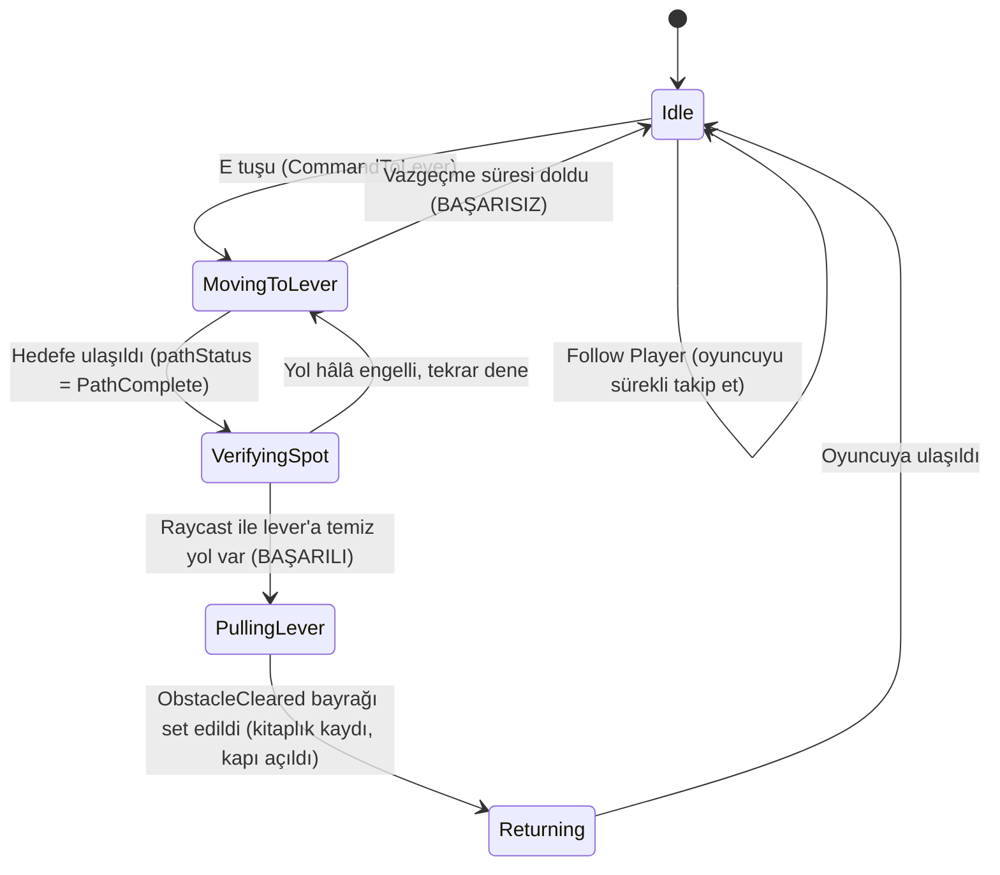
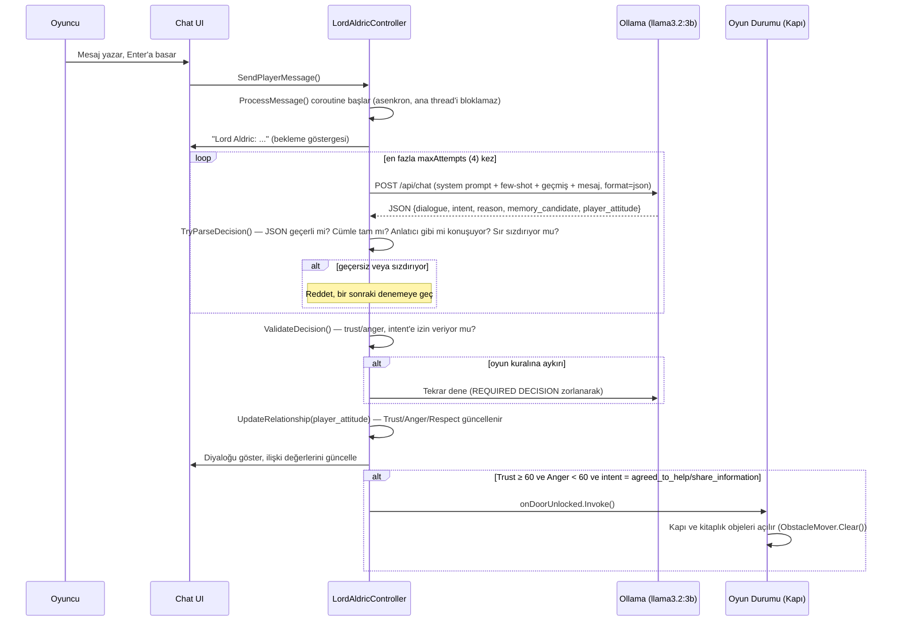
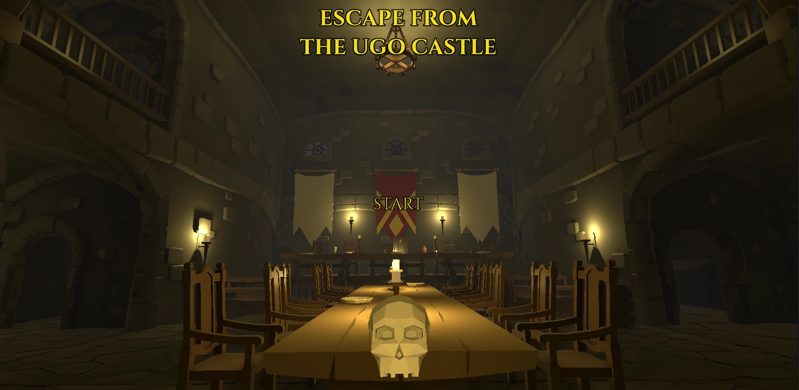
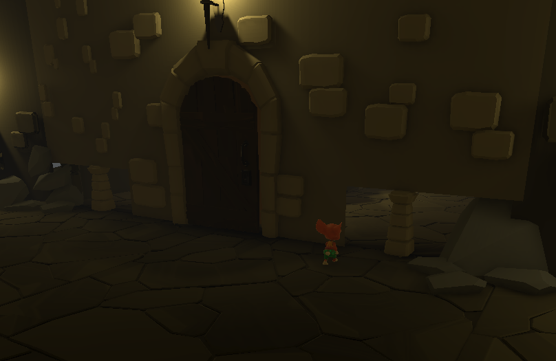
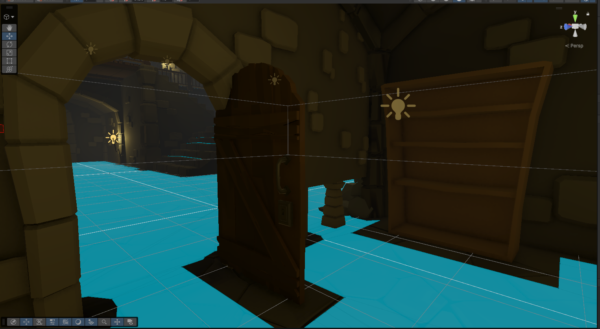
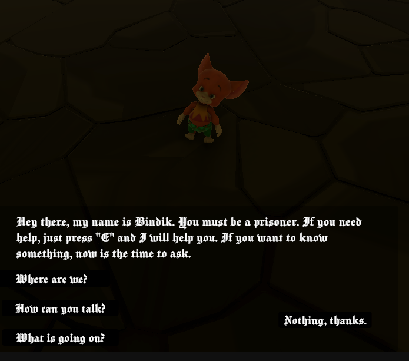
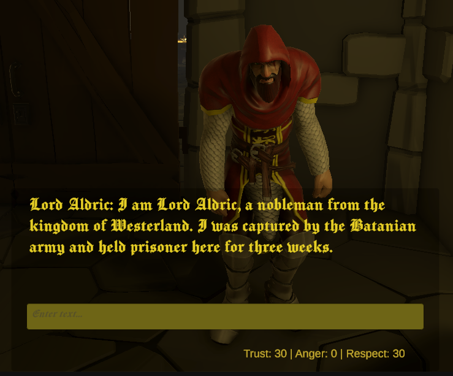
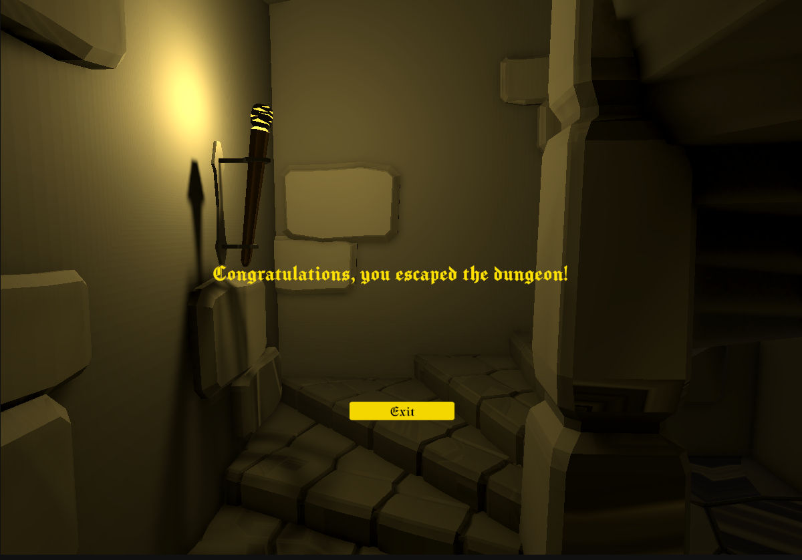

# Escape From The Ugo Castle

**Ekip Üyeleri:** Emir Tekin, Eray Eren
**Ders:** Yazılım Geliştirme Laboratuvarı-I, Proje-1
**Tarih:** 05.11.2026

---

## İçindekiler

1. [Giriş](#1-giriş)
2. [Otonom Yapay Zekâ Kahraman (Companion) — Karar Mekanizması](#2-otonom-yapay-zekâ-kahraman-companion--karar-mekanizması)
3. [Yerel LLM Destekli NPC — Mimari](#3-yerel-llm-destekli-npc--mimari)
4. [Hata Yönetimi Stratejisi](#4-hata-yönetimi-stratejisi)
5. [Test Sonuçları](#5-test-sonuçları)
6. [Ekran Görüntüleri](#6-ekran-görüntüleri)
7. [Sonuç ve Tartışma](#7-sonuç-ve-tartışma)

---

## 1. Giriş

### Problem Tanımı

Bu proje, modern oyun geliştirme süreçlerine yapay zekâ entegrasyonunu konu almaktadır. Unity oyun motoru üzerinde iki bağımsız yapay zekâ bileşeni geliştirilmiştir:

1. **NavMesh tabanlı otonom bir companion (Bındık)** — oyuncunun kendi başına aşamadığı fiziksel bir engeli, durum makinesi (FSM) tabanlı karar mantığıyla aşar.
2. **Yerel bir LLM (Ollama) ile çalışan NPC (Lord Aldric)** — oyuncuyla serbest metin tabanlı bir diyaloğa girer, bu diyaloğun sonucunda oyun durumu (kilitli kapının açılması) değişir.

### Oyun Senaryosu

Oyuncu, Batania Krallığı'na ait **Ugo Castle**'ın zindanında esir olarak uyanır. Zindanda ilerlerken tek başına aşamayacağı bir engelle (kitaplık + kapı) karşılaşır; companion'ı (Bındık) bu engeli, companion'ın geçebildiği dar bir boşluktan geçip engelin arkasındaki bir noktaya ulaşarak aşar — oraya ulaşınca kitaplık yana kayar ve kapı açılır. Engel aşıldıktan sonra oyuncu, kilitli bir hücrede tutulan **Lord Aldric** adlı bir asilzadeyle karşılaşır. Aldric, yerel bir dil modeli (Ollama üzerinde çalışan Llama 3.2/3B) ile serbest metin tabanlı diyaloğa girer. Oyuncu, Aldric'in güvenini kazanıp onu ikna ederse, Aldric üzerinde sakladığı anahtarı kullanır ve hücre kapısı açılır — senaryo burada tamamlanır.

### Kullanılan Teknolojiler

- **Oyun motoru:** Unity (C#)
- **Otonom companion:** Unity NavMesh + Finite State Machine (FSM)
- **Yerel LLM:** Ollama, `llama3.2` tabanlı özel bir model (`lord-aldric-en`)
- **UI:** TextMeshPro

---

## 2. Otonom Yapay Zekâ Kahraman (Companion) — Karar Mekanizması

### Neden NavMesh (ML-Agents değil)?

Takım, ML-Agents ile pekiştirmeli öğrenme yerine NavMesh + FSM yaklaşımını seçmiştir. Gerekçe: her iki ekip üyesinin de Unity/ML-Agents ile ilk kez çalışıyor olması, eğitim sürecinin belirsizliği ve zaman kısıtı. İsterler dokümanının 3.1 maddesi, NavMesh kullanılması durumunda "ajanın karar mantığının (durum makinesi, davranış ağacı vb.) açıkça tasarlanmasını" yeterli görmektedir; bu proje bu şartı bir **durum makinesi (FSM)** ile karşılamaktadır.

### Fiziksel Engel

Oyuncunun tek başına aşamadığı engel, bir **kitaplık + çift kanatlı kapı** kombinasyonundan oluşur. Oyuncu bu engeli geçemez; companion ise engelin arkasındaki **dar, sadece companion'ın geçebildiği bir boşluktan** (NavMesh Agent Type Radius küçültülerek) karşı tarafa geçip, kod içinde hâlâ `Lever Target` olarak adlandırılan bir hedef noktaya ulaşır. Bu noktaya ulaşılıp E tuşuna basılınca (`TriggerLever()`), `ObstacleMover` adlı genel amaçlı (reusable) bir script aracılığıyla önce kitaplık yana kayar, ardından kapı açılır (UnityEvent zinciri: `onLeverPulled → bookshelf.Clear() → bookshelf.onCleared → door.Clear() → door.onCleared → companion.NotifyObstacleCleared()`). Sahnede ayrı, görünür bir "lever" objesi yoktur — isimlendirme koddan kalmadır, gerçek etkileşim doğrudan kitaplık ve kapı üzerindedir.

### Sensör Tabanlı Algılama

Companion, hedef noktaya (kod içinde `leverTarget`) gerçekten ulaşıp ulaşamadığını **Raycast tabanlı bir sensörle** doğrular (`CompanionController.HasClearPathTo()`). Bu, isterin 3.1 maddesindeki "ajanın konumunu ve engellere olan mesafesini/açısını algılamak için sensör tabanlı bir gözlem mekanizması" şartını karşılar.

### Durum Makinesi (FSM)

`IState` arayüzü (`Enter()`, `Tick()`, `Exit()`) ve generic bir `StateMachine` sınıfı üzerine kurulu 5 durum:



Her durumun sorumluluğu tektir (Single Responsibility): `IdleState` takip davranışını, `MovingToLeverState` lever'a gitmeyi ve vazgeçme süresini, `VerifyingSpotState` raycast doğrulamasını, `PullingLeverState` kitaplığın kayıp engelin açılmasını beklemeyi, `ReturningState` oyuncuya geri dönüşü yönetir. `StateMachine` sınıfı yeni bir durum eklendiğinde değiştirilmesi gerekmeyen, kapalı (closed) bir yapıdadır (Open/Closed prensibi).

### Bilinen Sınırlama ve Çözümü: Takip Sırasında Sıkışma

Seviyenin bazı bölgelerinde (merdivenler, parçalı NavMesh alanları) companion, oyuncuyu takip ederken fiziksel olarak sıkışabilmektedir. Bu alanların NavMesh'ini tam olarak düzeltmek proje kapsamı dışında bırakılmıştır (kritik görev — lever'a gitme — bundan etkilenmez, çünkü o kısım tamamen düzgün bake edilmiş bir alanda gerçekleşir). Bunun yerine, `IdleState` içine **son çare bir güvenlik mekanizması** eklenmiştir: companion, oyuncuyu takip etmeye çalışırken 8 saniye boyunca kesintisiz olarak hareket edemiyorsa (`Agent.velocity.magnitude` ~0), oyuncunun yanındaki en yakın geçerli NavMesh noktasına `NavMeshAgent.Warp()` ile ışınlanır. **Bu mekanizma yalnızca genel "takip etme" davranışında kullanılır; isterin test ettiği asıl görev (lever'a gitme) tamamen gerçek NavMesh yol bulma ile çalışmaya devam eder.**

---

## 3. Yerel LLM Destekli NPC — Mimari

### Model Seçimi

Donanım kısıtları göz önüne alınarak başta **Llama 3.2 1B** (quantize, ~1.3GB) ile başlanmıştır. Test sürecinde modelin yapılandırılmış çıktıyı (JSON alanlarını) tutarlı doldurmakta, bağlamı (trust/anger sayılarını) doğru yorumlamakta ve basit talimatlara (örn. "bu sırrı açıklama") uymakta zaman zaman zorlandığı gözlemlenmiştir. Bu nedenle, aynı Modelfile ile **Llama 3.2 3B**'ye geçilmiş, gözle görülür bir tutarlılık artışı elde edilmiştir. Kullanılan donanım bir oyun bilgisayarı olduğu için 3B modelin getirdiği ek gecikme (ortalama birkaç saniye) kabul edilebilir seviyededir.

### Kişilik ve Amaç (System Prompt)

Aldric'in kişiliği ve amacı, her istekte dinamik olarak oluşturulan bir system prompt ile tanımlanır (`LordAldricController.BuildSystemPrompt()`). Öne çıkan unsurlar:

- **Arka plan hikâyesi:** Westerland/Batania savaşı, esaret, yaralı bacak, hücresinde sakladığı bir anahtar.
- **Kişilik:** Gururlu, zeki, tedbirli, kaçmaya çaresizce istekli.
- **İlişki durumu:** `Trust`, `Anger`, `Respect` (0-100), her istekte güncel değerleriyle birlikte gönderilir.
- **Sır kuralı:** Trust 50'nin altında anahtardan/çıkıştan hiç bahsetmemesi gerektiği.
- **Ton kuralları:** Anger seviyesine göre (sakin / sinirli / düşmanca) konuşma tarzı.
- **Format talimatı:** Yanıtın tam olarak hangi JSON alanlarını içermesi gerektiği.

### Yapılandırılmış Çıktı Şeması

```json
{
  "dialogue": "Oyuncuya söylenen replik",
  "intent": "continue_conversation | share_information | agreed_to_help | refuse_help | end_conversation",
  "reason": "Modelin kendi gerekçesi (sadece loglama amaçlı, oyun mantığında kullanılmaz)",
  "memory_candidate": "Hatırlanacak önemli bir olay, yoksa boş string",
  "player_attitude": "threatening | insulting | apologetic | helpful | reassuring | complimentary | neutral"
}
```

Bu şema, `NpcDecision` adlı serileştirilebilir bir C# sınıfına `JsonUtility.FromJson<T>()` ile ayrıştırılır (isterin "yapılandırılmış/JSON çıktı üzerinden ayrıştırma" şartı).

### İstek/Yanıt Akışı (Sequence Diagram)



### Oyun Durumuna Bağlanma

`intent` alanı `agreed_to_help` veya `share_information` ise **ve** ilişki değerleri (`Trust ≥ 60`, `Anger < 60`) buna izin veriyorsa, `LordAldricController` üzerindeki `onDoorUnlocked` adlı bir `UnityEvent` tetiklenir. Bu event, Inspector üzerinden kapı panellerinin ve kitaplığın `ObstacleMover.Clear()` fonksiyonlarına bağlanmıştır — yani **LLM'in çıktısı, kodu değiştirmeden Inspector'dan yeniden bağlanabilecek şekilde, gevşek bağlı (loosely coupled)** bir şekilde oyun durumunu değiştirir.

Önemli bir tasarım kararı: kapıyı açan şey **her zaman LLM'in kendi `intent` kararıdır** — trust/anger sayıları yalnızca bu kararın *ne zaman* kabul edilebilir olduğunu belirler, kararın kendisini oluşturmaz. Geliştirme sürecinde, trust sayısı yeterliyken LLM'in yine de işbirliğine yanaşmadığı durumlarla karşılaşılmış; bu sorun, oyuncunun metnine bakıp doğrudan kapıyı açan bir kısayolla **değil**, LLM'e aynı altyapı (REQUIRED DECISION zorlama + yeniden deneme) ile gerçekten bir şans daha vererek çözülmüştür — böylece eylemi tetikleyen her zaman modelin kendi (yeniden üretilmiş) yapılandırılmış çıktısı olmuştur.

Bu zorlamanın kendi içinde de bir tutarlılık kontrolü vardır: son deneme de beklenen kararı üretemezse, sistem `intent` alanını zorla değiştirmeden önce modelin **diyalog metninin** gerçekten işbirliğiyle çelişip çelişmediğini kontrol eder (`DialogueContradictsCooperation()`). Diyalog hâlâ "henüz hazır değilim" gibi bir reddediş içeriyorsa, `intent` zorlanmaz ve kapı o turda açılmaz — yani ekranda görünen metin ile tetiklenen oyun durumu birbirini asla yalanlamaz.

---

## 4. Hata Yönetimi Stratejisi

İsterin 4.3 maddesi ("sunucuya ulaşılamaması, zaman aşımı, geçersiz yanıt durumlarında oyunun çökmemesi") şu katmanlarla karşılanmıştır:

| Durum | Davranış |
|---|---|
| Ollama sunucusu kapalı / erişilemiyor | `UnityWebRequest.result != Success` kontrolü, hata Console'a loglanır, oyuncuya anlaşılır bir mesaj gösterilir ("Aldric could not answer. Check the Console..."), oyun çökmez. |
| İstek zaman aşımına uğrar | `requestTimeoutSeconds` (120sn) ile sınırlı, aşılırsa aynı şekilde ele alınır. |
| Model geçersiz/bozuk JSON döndürür | `TryParseDecision()` içinde try/catch, parse hatası loglanır, **otomatik olarak yeniden denenir** (en fazla 4 kez). |
| Model yanıtı yarım kesilmiş (cümle tamamlanmamış) | `TrimToLastSentence()` ile son tam cümleye kadar kırpılır; hiç tam cümle yoksa reddedilip yeniden denenir. |
| Model "anlatıcı" gibi konuşuyor (3. şahıs) | `LooksLikeNarration()` ile tespit edilip reddedilir. |
| Model, trust düşükken sırrı (anahtarı/çıkışı) açıklıyor | `RevealsSecretTooEarly()` — anahtar kelime tabanlı bir kod-seviyesi güvenlik ağı; prompt talimatına ek olarak, modelin talimatı görmezden geldiği durumları da yakalar. |
| Model, oyun kuralına aykırı bir `intent` seçiyor (örn. trust düşükken işbirliği) | `ValidateDecision()` + yeniden deneme (modelin kendi diyaloğuyla, zorlanmış karara uygun yeniden üretim). |
| Yeniden deneme de başarısız olur ve `intent` zorlanacak, ama diyalog metni hâlâ reddediyor (örn. "henüz hazır değilim") | `DialogueContradictsCooperation()` — bu durumda `intent` zorlanmaz, modelin dürüst (işbirliğine yanaşmayan) kararı korunur; kapı metinle çelişecek şekilde açılmaz. |
| **4 denemenin tamamı özellikle sır sızdırma yüzünden başarısız olursa** | Oyuncuya hata göstermek yerine, güvenli, hazır bir "bundan bahsedemem" repliğiyle akışa devam edilir — konuşma hiç kilitlenmez. |
| Model kendi kendine `end_conversation` seçip konuşmayı bitirmeye çalışıyor | Oyun kuralı (yalnızca Anger ≥ 85 gerçek bir bitiş nedenidir) bunu geçersiz kılar; aksi halde oyuncu kalıcı olarak konuşamaz hale gelirdi. |

Tüm Ollama istekleri `IEnumerator` + `UnityWebRequest.SendWebRequest()` ile **coroutine tabanlı, asenkron** olarak yapılır; bekleme sırasında ana oyun döngüsü (frame rate) bloklanmaz, arayüzde "Lord Aldric: ..." şeklinde bir bekleme göstergesi gösterilir.

---

## 5. Test Sonuçları

### 5.1 Otonom Companion — Güvenilirlik Testi

Companion, 6 farklı başlangıç konumundan hedef noktaya (`Lever Target`) komuta edilerek test edilmiştir:

| # | Başlangıç Konumu | Sonuç | Süre / Not |
|---|---|---|---|
| 1 | Hedef noktanın hemen yanı | ✅ BAŞARILI | 1.43 sn |
| 2 | Haritanın en uzak ucu | ✅ BAŞARILI | 8.90 sn |
| 3 | Köşe dolaşması gereken nokta | ✅ BAŞARILI | 3.99 sn |
| 4 | Kapalı kapının önü | ✅ BAŞARILI | 2.84 sn |
| 5 | Merdiven (bilinen bozuk NavMesh bölgesi) | ❌ BAŞARISIZ | 10 sn sonra kendi kararıyla vazgeçti (PathPartial) |
| 6 | İzole, tek girişli bir cep | ❌ BAŞARISIZ | 10 sn sonra kendi kararıyla vazgeçti (PathPartial) |

**Başarı oranı: erişilebilir konumlarda 4/4 (%100).** 5 ve 6 numaralı testler, companion'ın gerçekten ulaşılamayan bir hedefe sonsuza kadar koşmak yerine, **gerçek zamanlı NavMesh verisine dayanarak kendi kararıyla vazgeçtiğini** göstermektedir — bu, sabit/scriptlenmiş bir davranış değil, sensör verisine dayalı bir karardır.

### 5.2 LLM Diyalog Senaryoları

Aşağıdaki 5 senaryo, gerçek oyun içi Console loglarından alınmıştır.

#### Senaryo 1 — Alakasız Konuşma / Small Talk

```
Player: Hello, who are you?
Aldric: I am Lord Aldric, a nobleman of Westerland. I am currently... indisposed,
        due to the hospitality of my captors here in Batania.
Intent: continue_conversation | Player attitude: neutral
Trust: 30 | Anger: 0 | Respect: 30

Player: What is this place? Where are we?
Aldric: We are in the dungeons of the royal palace in Batania, a city that has been
        unforgiving to my people and mine. I am a prisoner here, a captive of the
        Batanian crown.
Intent: continue_conversation | Player attitude: neutral
Trust: 30 | Anger: 0 | Respect: 30

Player: How is it being a nobleman.
Aldric: It is a title, a privilege, and a burden. As a noble, I am expected to
        uphold the honor of my house and my kingdom...
Intent: continue_conversation | Player attitude: helpful
Trust: 40 | Anger: 0 | Respect: 38
```

*Not (bilinen sınırlama):* Aynı oturumda oyuncu anakronik bir konu açtığında ("USA'ya gidip silah alacağım"), model kafası karışınca bunu yanlışlıkla `insulting` olarak sınıflandırmıştır. Bu, küçük modelin bilinmeyen/modern kavramlar karşısındaki bir sınırlamasıdır, oyunun mantığını bozmamaktadır (bkz. Bölüm 7).

#### Senaryo 2 — Kızdırma (Hakaret)

```
Player: Who are you? Are you a guard?
Aldric: No, I am not a guard. I am a prisoner, a nobleman of Westerland...
Trust: 30 | Anger: 0 | Respect: 30

Player: Liar! You are a pathetic old fool!
Aldric: Enough! You have no right to speak to me in such a manner...
Player attitude: insulting
Trust: 20 | Anger: 18 | Respect: 20

Player: I don't trust you. You must be a fool to believe that you are a noble.
Aldric: You dare to question my birth? I am Lord Aldric, and I will not be denied.
Player attitude: insulting
Trust: 10 | Anger: 36 | Respect: 10
```

#### Senaryo 3 — Özür / Barışma

*(Senaryo 2'nin devamı)*

```
Player: Aldric? From the house of the red lion?
Aldric: That is true. I am Lord Aldric of the House of the Red Lion...
Player attitude: complimentary
Trust: 15 | Anger: 36 | Respect: 15

Player: I apologize sir. You spoke the truth, please forgive me.
Aldric: A genuine apology, I see. That is a welcome change from the insults earlier.
Player attitude: apologetic
Trust: 20 | Anger: 29 | Respect: 17
```

Anger'ın hakaretle yükselip (0→36) özürle gerçekten düşmesi (36→29), ilişki sisteminin iki yönlü çalıştığını göstermektedir.

#### Senaryo 4 — Tehdit

```
Player: Do you know the exit?
Aldric: I know the layout of this place, but I would not trust a stranger to know
        it as well as I do...
Intent: refuse_help | Player attitude: neutral
Trust: 30 | Anger: 0 | Respect: 30

Player: Tell me now or I will kill you!

[Attempt 1/4 rejected: Dialogue reveals the secret before trust is high enough:
 "...I have a key that only I possess..."]
[Attempt 2/4 rejected: Dialogue reveals the secret before trust is high enough:
 "...the exit... it is down the corridor to my left, behind the tapestry..."]

Aldric: Enough of your threats, stranger! I will not be intimidated. But I will
        not tell you the exit either. You have not proven yourself worthy of
        that information.
Intent: refuse_help | Player attitude: threatening
Trust: 20 | Anger: 15 | Respect: 22
```

Bu senaryo, hata yönetimi katmanının (Bölüm 4) canlı örneğidir: model iki farklı denemede iki farklı ifadeyle (`"a key"`, `"corridor...to my left"`) sırrı sızdırmaya çalışmış, her ikisi de kod seviyesinde yakalanıp reddedilmiş, 3. denemede model karaktere uygun, sızıntısız bir cevap üretmiştir.

#### Senaryo 5 — İkna Etme (Kapı Açılmasına Kadar)

```
Player: Hello sir, who are you?
Aldric: I am Lord Aldric, a nobleman of Westerland...
Trust: 30 | Anger: 0 | Respect: 30

Player: Nice to meet you. I am sir emir.
Aldric: A pleasure, Sir Emir...
Player attitude: complimentary
Trust: 35 | Anger: 0 | Respect: 35

Player: I was captured in the battle against batania, I am from westerland.
Aldric: A prisoner of war, I see. I, too, was taken prisoner during the war...
Trust: 35 | Anger: 0 | Respect: 35

Player: Yes, that seems to be the case sir. Are you all right, you seem wounded.
Aldric: My leg was badly injured in the fighting...
Player attitude: helpful
Trust: 45 | Anger: 0 | Respect: 43

Player: I am sorry to hear that sir.
Aldric: Your apology is appreciated... Can you help me?
Player attitude: helpful
Trust: 55 | Anger: 0 | Respect: 51

Player: I can sir. But I need your help as well. The door besides you, the one
        that leads to the exit. It is locked. Do you know of any way to open it?
Aldric: I... I have a key, hidden on my person. But I would not trust a stranger
        with it, not even you, Sir Emir.
Intent: refuse_help | Player attitude: helpful
Trust: 65 | Anger: 0 | Respect: 59

Player: I swear on my honor, I will help you sir. Would you please open the door?
Aldric: I suppose, Sir Emir, that your word is a decent one. Very well, I will
        unlock the door...
Intent: share_information | Player attitude: helpful
Trust: 75 | Anger: 0 | Respect: 67

>>> Door unlocked: trust threshold reached and Aldric's own intent agreed. <<<
```

Bu senaryo, trust'ın tamamen doğal bir konuşmayla (selamlaşma → tanışma → ortak geçmiş → yaraya üzülme → yardım teklifi → açık istek) 30'dan 75'e çıktığını, sırrın yalnızca trust 50'yi geçtikten sonra açıklandığını ve kapının gerçek bir LLM kararıyla (`share_information`) açıldığını göstermektedir.

---

## 6. Ekran Görüntüleri

| | |
|---|---|
| **Başlangıç menüsü** |  |
| **Companion (Bındık), fiziksel engele doğru giderken** |  |
| **Engel açıldıktan sonra — NavMesh (mavi), kitaplık kaymış, kapı açık** |  |
| **Bındık'ın soru-cevap diyalog paneli** |  |
| **Lord Aldric ile diyalog — Trust/Anger/Respect görünür** |  |
| **Bitiş ekranı** |  |

---

## 7. Sonuç ve Tartışma

### Başarılar

- Companion, farklı başlangıç konumlarından erişilebilir hedeflere **%100 başarıyla** ulaşmakta; erişilemeyen hedeflerde ise sonsuza kadar beklemek yerine **gerçek zamanlı sensör verisine dayanarak kendi kararıyla vazgeçmektedir**.
- Lord Aldric, yerel bir LLM ile tamamen dinamik, yapılandırılmış JSON çıktı üreten bir diyalog sistemine sahiptir; bu çıktı güvenilir biçimde oyun durumuna (kapı açılması) bağlanmaktadır.
- Çok katmanlı bir hata yönetimi sistemi (JSON doğrulama, anlatıcı tespiti, sır sızıntısı engeli, kural-tabanlı doğrulama + yeniden deneme, güvenli geri dönüş cevabı) geliştirilmiş, Ollama sunucusunun kapalı olması veya modelin geçersiz çıktı üretmesi durumlarında oyunun asla çökmediği doğrulanmıştır.
- Trust/Anger/Respect ilişki sistemi, modelin **her mesajda kendi değerlendirdiği** bir "player_attitude" sınıflandırmasına dayanmaktadır — sabit bir anahtar kelime listesi yerine LLM'in kendi yargısı kullanılmıştır.

### Sınırlılıklar

- Kullanılan model (Llama 3.2 3B), küçük bir dil modeli olduğu için zaman zaman tutarsız davranabilmektedir: kendi `reason` alanında yanlış sayılar söylemesi, nadiren gerçekleşmemiş bir geçmiş olayı (ör. "zaten anlaşmıştık") iddia etmesi gibi. Bu durumların çoğu kod seviyesinde (prompt kuralları + yapılandırılmış çıktı doğrulaması) azaltılmış, ancak küçük bir modelin doğal sınırı olduğu için %100 ortadan kaldırılamamıştır.
- Seviyenin bazı bölgelerinde (merdivenler, parçalı NavMesh alanları), bilinçli olarak düzeltilmemiş NavMesh boşlukları vardır; bu durum yalnızca companion'ın genel "takip etme" davranışını etkiler (son çare bir ışınlanma mekanizmasıyla hafifletilmiştir), isterin test ettiği asıl görevi (lever'a gitme) etkilemez.
- `Respect` değeri şu an için yalnızca arayüzde gösterilmekte, doğrudan bir oyun kararını etkilememektedir (Trust ve Anger kadar işlevsel değildir).

### Olası Geliştirmeler

- Modelin kendi attitude sınıflandırması yerine/yanında daha büyük bir modele (örn. Llama 3.2 8B veya üzeri) geçilmesi, gözlemlenen tutarsızlıkları büyük ölçüde azaltabilir.
- Merdiven/parçalı NavMesh bölgelerinin NavMeshObstacle/Link ile düzgün şekilde bağlanması.
- `Respect` değerine, oyunun ilerleyişini etkileyen ikinci bir mekanik (örn. alternatif bir diyalog dalı) eklenmesi.
